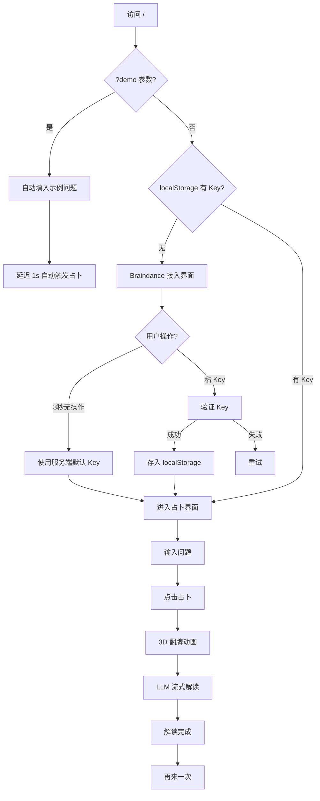

# PRD v3.2：CyberTarot 赛博占卜师 — AI 驱动的原创世界观塔罗占卜体验

## 1. 项目定位

一个面向求职展示的 AI 塔罗占卜 Web 应用，通过「预生成赛博风格塔罗牌面 + LLM 角色化深度解读 + 3D 沉浸式 UI」三位一体，填补中文 AI 塔罗 Web 产品的空白。

**一句话定义：**
用户输入问题 → 虚拟抽三张牌 → 金属框卡面 3D 翻转展示 → DeepSeek 以「2077 赛博占卜师」角色流式解读。

### 1.1 概念故事

> 2077 年，赛博先知们从旧世界的废墟中发掘出古老的手稿预言纸，将它们保存在金属画框中——每一张都是一个预言碎片。用户接入 Braindance 神经接口后，先知会为其抽取三张「遗物卡牌」，解读过去的痕迹、现在的能量和未来的可能。

### 1.2 技术选型（更新）

| 层 | 技术 | 理由 |
|----|------|------|
| 前端框架 | **Next.js App Router** (React + TypeScript) | SSR/SSG，动画生态成熟 |
| 3D 引擎 | **React Three Fiber** (精简范围：翻牌 + 粒子背景，砍掉洗牌/飞入动画) | 保留核心视觉冲击，节省 ~1.5 天工期 |
| UI 动画 | **Framer Motion** | 入场动画、状态过渡、段落浮现效果 |
| 样式 | **Tailwind CSS** 定制暗黑主题 | 霓虹蓝紫配色：`#0a0a1a` / `#00f0ff` / `#b44dff` |
| LLM | **DeepSeek API** | 性价比高、中文能力强 |
| 图像生成 | **NanoBanana** (Google Gemini API) | 78 张一次性预生成，~$5.24 |
| 图像存储 | `public/assets/cards/*.webp` → R3F 直接加载 | **注意：** R3F 的 useTexture 跳过 Next.js 优化管道，需预压缩 |
| 状态管理 | **双 Context 架构** (TarotContext + ReadingContext) | 流式 token 不触发 3D 场景重渲染 |
| 错误边界 | **ErrorBoundary** 包裹 R3F 场景 | WebGL 崩溃时降级到 CSS 2D 卡牌 |
| API Runtime | **Vercel Node.js Serverless Functions** | DeepSeek Node.js fetch + ReadableStream 兼容性最佳；Hobby Plan 10s 内可完成 ~600 字生成 |
| 数据管理 | TypeScript 常量 + 运行时内存 | MVP 无需数据库 |

### 1.3 站点入口

| 环境 | URL | 用途 |
|------|-----|------|
| 生产环境 | `https://cybertarot.vercel.app` | 面试演示、公网访问 |
| Demo 模式 | `https://cybertarot.vercel.app/?demo` | 自动填问题触发占卜，面试官零操作 |
| 预览分支 | `https://cybertarot-git-xxx.vercel.app` | 功能分支自动部署 |
| 本地开发 | `http://localhost:3000` | 开发调试 |

## 2. 竞品分析

### 2.1 直接竞品

| 产品 | 形态 | AI 程度 | 中文 | 你的优势 |
|------|------|--------|------|---------|
| **Chatarot.ai** | Web, 3D 翻牌桌 | LLM 解读+追问 | ❌ | 免费+中文，定位不同 |
| **Tarotap** | Web | LLM+专业解读 | ❌ | 免费+原创卡面 |
| **Lumi** | App | AI 解读+星座 | ❌ | 不在移动端赛道 |
| **chatgpt-tarot-divination** | GitHub 纯文字 | LLM 解读 | ✅ | 你的项目有完整视觉体验 |
| **小红书 AI 塔罗博主** | 图文/付费 | ChatGPT 生成 | ✅ | 你的 Web 产品可降维打击 |
| **CyberTarot（你）** | **Web 3D** | **LLM+原创卡面** | **✅** | **中文 AI 塔罗 Web 蓝海入口** |

### 2.2 差异化定位

市场上没有同时做到「中文 + AI 原创卡面 + LLM 深度解读 + 3D 沉浸式 Web 体验」的产品。CyberTarot 填补了这个空白。

与 CopyAI（实用型 SaaS）形成互补，展示从实用型到趣味型的 AI 产品广度。

## 3. 目标用户

| 角色 | 需求 |
|------|------|
| **核心用户** (18-30 岁) | 沉浸式占卜体验，个性化解答 |
| **实际受众：面试官** | 评估 AI 产品整合能力、产品设计思维、快速原型能力 |
| **延伸用户** (AI demo 浏览者) | 体验 AI 多模态整合 demo |

## 4. 核心功能 MVP 范围

### 第一版必须包含

- ✅ 用户输入文本问题（200 字限制）
- ✅ 3D 翻牌场景（React Three Fiber：粒子背景 + 卡牌 3D 翻转）
- ✅ 78 张牌 Fisher-Yates 洗牌 + 不重复抽三张（正逆位 70/30 随机）
- ✅ 三张牌按「过去 — 现状 — 未来」阵型展示
- ✅ 卡牌 3D 翻转动画（牌背 → 牌面）
- ✅ 预生成赛博风格卡面（金属框 + 羊皮卷 linocut 风格）
- ✅ 每张牌显示牌名（中文+英文）+ 正逆位标记
- ✅ DeepSeek API 「2077 赛博占卜师」角色个性化流式解读
- ✅ 三张牌单独解读 + 组合解读 + 核心回答
- ✅ Braindance 接入界面（API Key 双模式：服务端内置默认 Key + 用户自有 Key）
- ✅ 暗黑神秘风格 UI（Tailwind CSS，霓虹蓝紫配色）
- ✅ 「再来一次」按钮清空重置
- ✅ 部署到 Vercel + 自定义域名
- ✅ `/?demo` 面试模式（自动填入问题 + 自动触发占卜）

### 第一版不做

- ❌ 用户注册/登录
- ❌ 数据库存储
- ❌ 商业化变现/广告
- ❌ 多语言版本
- ❌ 多种牌阵（仅三牌阵）
- ❌ 多种 AI 读者角色
- ❌ 历史记录/分享功能
- ❌ 自定义牌面风格
- ❌ 洗牌/飞入牌阵 3D 动画（精简约了，保留翻牌核心体验）

## 5. 页面架构

### 5.0 路由设计

| 路由 | 页面 | 说明 |
|------|------|------|
| `/` | 首页/占卜主界面 | 核心体验：Braindance 接入 → 3D 翻牌桌 → 解读区 |
| `/about` | 关于项目 | 技术决策看板、架构图、设计理念、遇到的挑战 |
| `/cards` | 78 张牌百科 | 全部塔罗牌展示，支持按花色筛选 |

### 5.1 双 Context 状态架构

使用双 Context 隔离渲染范围，避免流式 token 触发 3D 场景重渲染：

**TarotContext** — 控制核心占卜流程（不随 reading 刷新）

```typescript
interface TarotState {
  phase: 'braindance' | 'input' | 'shuffling' | 'drawing' | 'reading' | 'done' | 'error'
  question: string
  cards: DrawnCard[]
  error: string | null
  apiKey: string | null  // localStorage 持久化
}

type TarotAction =
  | { type: 'SET_QUESTION'; question: string }
  | { type: 'START_READING'; cards: DrawnCard[] }
  | { type: 'FINISH_READING' }
  | { type: 'SET_ERROR'; error: string }
  | { type: 'SET_API_KEY'; key: string }
  | { type: 'RESET' }
```

**ReadingContext** — 管理流式段落（segment），每次 APPEND 不波及 3D 场景

```typescript
interface ReadingState {
  paragraphs: string[]       // 已完成段落（按 ## 切分）
  streamingParagraph: string // 正在流式缓冲中的内容
  isStreaming: boolean
}

type ReadingAction =
  | { type: 'APPEND_PARAGRAPH'; text: string }  // 完成一个段落
  | { type: 'STREAM_CHUNK'; text: string }       // 追加到当前缓冲
  | { type: 'CLEAR' }
```

**性能保障：**
- TarotTable3D 用 `React.memo()` 包裹，只对 cards/phase 变化响应
- ReadingStream 按段落粒度更新（完整段落到达时一次渲染），无逐 token DOM 操作

### 5.2 核心页面布局（首页 `/`）

```
┌─────────────────────────────────────────────┐
│  🎴 CyberTarot 2077    [About] [Cards]      │  ← Navbar
│  "在数据的洪流中，寻找你的命运"               │
├─────────────────────────────────────────────┤
│                                             │
│  [Braindance 接入] 或 [输入区] ────────────  │  ← 条件渲染
│                                             │   首次 → Braindance
│  ┌───── 3D 翻牌桌 ────────────────────┐     │   已有 Key → 输入区
│  │   [粒子背景 + 三张卡牌翻转展示]     │     │  ← R3F (懒加载)
│  │   过去        现状        未来       │     │
│  └─────────────────────────────────────┘     │
│                                             │
│  ──── 赛博占卜师的解读 ────                  │  ← 流式输出
│  [Framer Motion 逐段浮现]                    │
│                                             │
│  [ 🔄 再来一次 ]                             │
└─────────────────────────────────────────────┘
```

### 5.3 R3F 组件架构（防 SSR 崩溃 + 错误恢复）

```typescript
// ❌ 错误做法 — 服务端渲染崩溃
import TarotTable3D from '@/components/TarotTable3D'

// ✅ 正确做法 — 懒加载 + SSR 禁用 + 骨架屏占位
const TarotTable3D = dynamic(
  () => import('@/components/TarotTable3D'),
  { ssr: false, loading: () => <CardSkeleton /> }
)
```

**纹理生命周期管理：**
- 翻牌前预加载 3 张牌的正面纹理（`new Image()` → 确认 `onload` 后再触发翻牌动画）
- 每次「再来一次」重置时调用 `texture.dispose()` 释放显存
- 仅保留 card_back 常驻纹理，其余按需加载/释放

**错误边界：**
- 用 ErrorBoundary 包裹 `<Canvas>` 组件
- WebGL 崩溃 / GPU 上下文丢失时，降级显示 CSS 2D 卡牌（纯 HTML 翻牌动画）
- 降级后提示「3D 加速不可用，已切换至经典模式」

### 5.4 面试 Demo 模式 (`/?demo`)

- URL 参数 `?demo` → 跳过 Braindance，自动填入预设问题「我最近的事业运如何？」
- 页面加载后延迟 1 秒自动触发占卜（模拟用户点击）
- 面试官打开链接即可看到完整的 3D 翻牌 + AI 解读
- URL 参数 `/?q=我的问题` 可自定义问题

## 6. 图片素材处理

### 6.1 卡牌风格

- **金属框 + 羊皮卷纸 + linocut 雕刻风格**
- 纯黑背景，卡牌居中
- 画面仅用一种 teal-blue 发光色作为唯一彩色点缀
- 全部 78 张 + 1 张卡背，NanoBanana (Gemini) 预生成

### 6.2 文件结构

```
public/assets/cards/
├── major_00_fool.png ~ major_21_world.png   // 22 张大阿卡纳
├── wands_01_ace.png ~ wands_14_king.png      // 14 张权杖
├── cups_01_ace.png ~ cups_14_king.png        // 14 张圣杯
├── swords_01_ace.png ~ swords_14_king.png    // 14 张宝剑
├── pentacles_01_ace.png ~ pentacles_14_king.png // 14 张星币
└── card_back.png                              // 1 张卡背
```

### 6.3 图片优化策略（关键）

**R3F 纹理加载特性（重要）：**
React Three Fiber 的 `useTexture` / `TextureLoader` **直接加载原始文件，跳过 Next.js 的图片优化管道**。这意味着如果不做预压缩，78 张 ~2MB 的 PNG 会在翻牌时直接被加载到 GPU 显存，导致：
1. 翻牌动画延迟（等待纹理加载完成）
2. 长时间运行后显存膨胀

**压缩方案（Sharp 自动脚本）：**
- 在 `scripts/compress-cards.mjs` 中编写 Node.js Sharp 批量处理脚本
- 读取 `public/assets/cards/` 下所有 `*.png` → 输出 WebP 格式，512×700px 分辨率
- 单张从 ~2MB → ~200KB，总体积从 156MB → ~16MB
- 脚本挂载到 `package.json` 的 `prebuild` 钩子，每次构建自动执行
- 原 PNG 保留作为备选纹理源

**加载策略：**
- 首屏：仅加载 card_back.webp（常驻纹理）
- 抽牌后：预加载 3 张牌的正面纹理 → 确认加载完成 → 再触发翻牌动画
- 重置时：调用 `texture.dispose()` 释放旧纹理
- /cards 百科页：使用 `next/image` 加载缩略图（此路径经过优化管道）

## 7. 后端实现

### 7.1 项目文件结构

```
cybertarot/
├── public/assets/cards/          ← 78+1 张已处理 PNG
├── src/
│   ├── app/
│   │   ├── page.tsx              ← 首页（占卜主界面）
│   │   ├── about/page.tsx        ← 关于项目
│   │   ├── cards/page.tsx        ← 78 张牌百科
│   │   ├── layout.tsx            ← 全局布局（Navbar + 暗黑主题）
│   │   └── api/
│   │       ├── reading/route.ts  ← POST /api/reading（流式解读）
│   │       └── verify-key/route.ts ← POST /api/verify-key
│   ├── components/
│   │   ├── TarotTable3D.tsx      ← 3D 翻牌桌（R3F, 懒加载, React.memo）
│   │   ├── CardMesh.tsx          ← 单张 3D 卡牌 mesh（含 dispose 逻辑）
│   │   ├── ParticleBg.tsx        ← 粒子背景
│   │   ├── ReadingStream.tsx     ← 流式解读（逐段浮现，独立 Context）
│   │   ├── QuestionInput.tsx     ← 输入区
│   │   ├── BraindancePortal.tsx  ← API Key 接入界面
│   │   ├── TarotProvider.tsx     ← TarotContext（核心流程状态）
│   │   ├── ReadingProvider.tsx   ← ReadingContext（流式文本状态）
│   │   ├── R3FErrorBoundary.tsx  ← 3D 场景错误边界（崩溃降级 CSS 2D）
│   │   ├── CardSkeleton.tsx      ← 3D 场景懒加载占位骨架屏
│   │   └── DemoTrigger.tsx       ← /?demo 参数检测 + 自动触发
│   ├── data/
│   │   └── cards.ts              ← 78 张牌数据（TypeScript 常量）
│   ├── lib/
│   │   ├── drawEngine.ts         ← 抽牌引擎
│   │   └── deepseek.ts           ← DeepSeek API 客户端
│   └── types/
│       └── index.ts              ← 类型定义
├── scripts/
│   └── compress-cards.mjs        ← Sharp 批量转 WebP 脚本
├── __tests__/
│   ├── drawEngine.test.ts        ← 抽牌逻辑测试
│   └── cards.test.ts             ← 卡牌数据完整性测试
├── package.json
├── tsconfig.json
├── tailwind.config.ts
├── next.config.js
└── jest.config.ts
```

### 7.2 API Key 双模式策略（更新）

```
用户访问 /
    │
    ├── localStorage 有 Key → 直接显示输入区
    │
    └── localStorage 无 Key → 显示 Braindance 接入界面
            │
            ├── 用户不操作 → 服务端默认 Key 自动激活（3 秒后自动跳过）
            │
            └── 用户粘贴自有 Key → 验证后存入 localStorage
```

**安全措施：**
- 服务端默认 Key 放在 Vercel 环境变量，存 $2 预算够数百次占卜
- 用户自有 Key 存在浏览器 localStorage，服务端不存储
- 添加简单每日限额（localStorage 计数器，每日 30 次）

### 7.3 Prompt 工程（压缩版，~600 字）

角色 prompt 采用 **Markdown 分段输出**（DeepSeek 流式返回整段 Markdown，前端按 `##` 标题切分为独立段落再逐段浮现）：

```
你是 CyberTarot 赛博占卜师，生活在 2077 年的霓虹都市。
你的语气：略带赛博诗意的神秘感，冷静深刻，不故弄玄虚。

输出格式（严格按以下顺序，用 ## 标题分段）：

## 过去的牌：{牌名}（正位/逆位）
60-80 字解读，联系牌面视觉元素。

## 现状的牌：{牌名}（正位/逆位）
60-80 字解读，联系牌面视觉元素。

## 未来的牌：{牌名}（正位/逆位）
60-80 字解读，联系牌面视觉元素。

## 组合解读
120-150 字，将三张牌串联成「过去→现状→未来」的叙事线。

## 核心回答
80-100 字，针对用户问题的具体回答。

规则：
- 正位=顺畅/显化，逆位=阻塞/内省，解读要明显区分
- 结合用户具体问题，不套模板
- 不说"根据塔罗牌显示"，你就是赛博占卜师
- 总字数控制在 500-650 字
```

### 7.4 流式解读与段落浮现优化

使用 **逐段浮现（Paragraph Fade-in）** 替代传统打字机效果，保留流式输出的"正在进行"感，同时大幅压缩展示时间：

- **段落切分规则：** 前端收到 DeepSeek 流式 Markdown 后，按 `##` 标题分割为独立段落。完整收到一个段落后才渲染
- **浮现动画：** 每段使用 Framer Motion `motion.div` 做 fade-in + translateY(10→0)，时长 300ms/段
- **段落间隔：** 段与段之间 200ms 延迟，形成"思辨式分段浮现"的节奏感
- **段落标题：** `## 过去的牌：{牌名}（正位/逆位）` 等标题无需等待整段完整才显示，标题到达即现（150ms 淡入），正文继续流式缓冲
- **总展示时间：** 5 个段落 × 300ms = **~2s**（对比打字机 18s），且与 LLM 生成并行——DeepSeek 推流的同时前端在实时缓冲和渲染
- **AbortController：** 支持用户中途取消解读（面板显示中止按钮），客户端断开时同步中止服务端 DeepSeek 请求，避免浪费 token
- **流式中断自动重试：** 最多 2 次，间隔 1 秒
- **降级方案：** DeepSeek API 不可用时，用前端缓存的模板生成解读（面试演示不卡住）
- **Runtime：** 使用 **Node.js Serverless Functions**。DeepSeek 的 Node.js fetch + ReadableStream 兼容性经过充分验证，是确定性方案
- **流式实现：** `POST /api/reading` 返回 `ReadableStream`，前端通过 `Response.body.getReader()` 逐 chunk 读取，累积到 `##` 标题分隔符后切分为段落

**状态管理配合：**
- ReadingContext 从原来的 `{ text: string, isStreaming: boolean }` 扩展为 `{ paragraphs: string[], streamingParagraph: string, isStreaming: boolean }`
- 每完整收到一个段落，`dispatch({ type: 'APPEND_PARAGRAPH', text })`，ReadingStream 读取 `paragraphs` 数组渲染已完成的段落
- 正在流式缓冲中的内容存在 `streamingParagraph`，可显示可选的光标指示器

## 8. 关键用户链路



## 9. 测试策略

| 测试 | 文件 | 内容 |
|------|------|------|
| 单元测试 | `drawEngine.test.ts` | 抽牌不重复、78 张全覆盖、正逆位概率 |
| 单元测试 | `cards.test.ts` | 卡牌数据完整、ID 无重复、图片文件存在 |
| 组件测试 | （可选） | Braindance 状态机转换 |

## 10. 面试展示策略

### 10.1 在线演示路径

1. 面试官收到链接 → 打开 `cybertarot.vercel.app/?demo`
2. 页面自动加载 → 预设问题自动填入 → 3D 翻牌开始
3. 15 秒内完成「问题 → 翻牌 → AI 解读」完整闭环
4. 面试官零操作，直接体验

### 10.2 面试话术要点

```
- 差异化：中文 + 原创赛博卡面 + LLM 深度解读，市面上唯一
- 技术深度：Next.js + R3F 集成（SSR 安全）、State Context 状态管理、流式 LLM 解读
- 设计决策：为什么预设卡面而不是实时生成（成本、一致性、速度）
- 概念驱动：Braindance 接入、金属框遗物卡牌——用世界观包装技术
- 项目组合：和 CopyAI（实用 SaaS）形成「实用 + 趣味」双项目展示
```

### 10.3 About 页面内容清单

- 项目定位与概念故事
- 技术栈选型与决策理由
- 系统架构图（Mermaid）
- 78 张牌生成流程
- 开发中解决的 2-3 个技术挑战
- 与 CopyAI 的项目组合展示

## 11. 边缘情况处理

| 场景 | 预期行为 |
|------|---------|
| 空问题点击占卜 | 提示「请输入你的问题」，输入框抖动 |
| 超长问题 | 输入框 200 字截断，实时提示 |
| 卡面缺失 | 显示 card_back.png 占位 |
| LLM API 失败 | 错误提示，保留已展示卡牌 |
| 网络断开 | 提示「连接超时」 |
| WebGL 不支持 / GPU 上下文丢失 | ErrorBoundary 捕获 → 降级到 CSS 2D 翻牌 + 提示「已切换至经典模式」 |
| 快速连续点击 | 按钮 disabled + 状态锁 |
| Vercel Serverless 超时 | 控制解读总长约 600 字，Hobby Plan 10s 内可完成生成 |
| DeepSeek 流式中断 | 自动重试（最多 2 次，间隔 1 秒）|
| R3F 纹理加载失败 | 加载 card_back.png 作为 fallback 纹理 |
| 翻牌时纹理未就绪 | 预加载机制：确认图片 onload 后再触发 180° 翻转 |
| 多次「再来一次」 | Texture.dispose() 释放旧纹理，防止显存泄漏 |
| 服务端默认 Key 超额 | 提示「今日神谕次数已达上限，可自备记忆芯片继续」|

## 12. 非功能要求

| 要求 | 标准 |
|------|------|
| 单次占卜总耗时 | ≤ 15 秒（含 3D 动画 + LLM 流式） |
| 3D 场景首次加载 | < 3 秒（懒加载 + 骨架屏占位） |
| LLM 首 token | < 4 秒（Node.js Serverless 冷启动） |
| 桌面端适配 | 1920×1080 优先，响应式降级到 1024×768 |
| 图片加载 | 按需加载 + 翻牌前纹理预加载 |
| 错误反馈 | 中文友好提示，不暴露技术细节 |
| 动画性能 | 3D 保持 60fps，低配降粒子数量 |
| 纹理内存 | 常驻仅 card_back 一张，翻牌后释放旧纹理 |
| 性能预算 | FCP < 2s, TTI < 3s, 3D scene load < 3s |
| 社交分享 | Open Graph 标签（og:title/description/image） |
| 键盘快捷键 | Enter 触发占卜、Esc 取消解读 |
| SEO | 各页面独立 meta title/description |

## 13. 开发顺序（调整版）

| 阶段 | 内容 | 时间 |
|------|------|------|
| **M1: 项目初始化** | create-next-app + 依赖 + 暗黑主题 + 文件结构 | Day 1 上午 |
| **M2: 牌库 + 抽牌引擎** | 78 张牌数据 + drawEngine + 单元测试 | Day 1 下午 |
| **M3: 卡面处理** | 图片压缩到合理尺寸，优化加载策略 | Day 1-2 并行 |
| **M4: 3D 翻牌桌** | R3F 粒子背景 + 卡牌翻转动画（精简版，无洗牌/飞入） | Day 2 |
| **M5: LLM 解读** | DeepSeek API Route + 流式组件 + Prompt 优化 | Day 2-3 并行 |
| **M6: UI 集成** | Braindance + 状态管理 + 输入区 + 完整流程 + /about + /cards | Day 3-4 |
| **M7: 部署+面试准备** | Vercel 部署 + 域名 + README + demo 模式 + About 页面内容 | Day 4-5 |

## 14. 素材就绪清单

| 素材 | 状态 | 备注 |
|------|------|------|
| 78 张卡牌面 | ✅ 已就位 | `public/assets/cards/`，去底透明 PNG（待 Sharp 脚本压缩为 WebP） |
| 卡背 | ✅ 已就位 | `card_back.png` |
| Card Prompts | ✅ 已就位 | `cybertarot_card_prompts_v4.md` |
| PRD | ✅ 已更新 | v3.1 |
| DeepSeek API Key | ✅ 已就位 | 服务端默认 Key 已配置 |
| 78 张牌结构化数据 | ⏳ 启动阶段生成 | `src/data/cards.ts`，含中英文名/关键词/正逆位释义 |
| GitHub 仓库 | ⏳ 需准备 | 空仓库用于推代码 |
| 项目 Logo | 🟡 推荐 | 浏览器标签+社交媒体卡片用 |
| 字体选型 | 🟡 推荐 | 标题 Orbitron/Rajdhani，正文 Inter |
|
|### 1.4 关键设计决策总结
|
|| 决策 | 选择 | 原因 |
||------|------|------|
|| Prompt 字数 | ~600 字（压缩版） | Hobby Plan 10s 超时限制，需确保 10s 内完成生成 |
|| API Runtime | Node.js Serverless Functions | DeepSeek fetch + ReadableStream 兼容性最佳 |
|| 解读展示 | 逐段浮现（非打字机） | 保留流式视觉效果，总展示时间 ~2s 而非 18s |

## 15. 修订记录

| 版本 | 日期 | 变更 |
|------|------|------|
| 1.0 | 2026-07-14 | 初始草案 |
| 2.0 | 2026-07-14 | 全面重构：系统架构图、角色权限、页面架构、数据模型 |
| 2.1 | 2026-07-14 | 技术选型从 Gradio → Next.js + R3F + Framer Motion |
| 2.2 | 2026-07-14 | 新增 Braindance 记忆植入协议 |
| **3.0** | **2026-07-14** | **头脑风暴后全面优化：精简 3D 范围、双模式 API Key、State Context 架构、R3F SSR 安全策略、图像优化策略、Prompt 结构化输出、流式体验增强、/?demo 面试模式、测试策略、About 页面增强、素材就绪清单** |
| **3.1** | **2026-07-14** | **系统审查修复 + 最终决策：双 Context 隔离、R3F 纹理预加载 + dispose、ErrorBoundary 降级、Markdown 流式替代 JSON、图片 WebP 压缩方案(Sharp脚本)、API Runtime 从 Edge 改为 Node Serverless、DeepSeek Key 已就绪、78 张牌数据启动阶段生成、OG 标签、键盘快捷键、性能预算指标** |
| **3.1** | **2026-07-14** | **系统审查修复：双 Context 隔离（ReadingContext 避免每 token 重渲染 3D）、R3F 纹理预加载 + dispose 时序管理、ErrorBoundary 降级方案、Markdown 流式替代 JSON、图片压缩为 WebP (R3F 绕过 Next.js 优化管道)、Vercel Edge Runtime 应对 10s 超时、Open Graph 社交标签、键盘快捷键、/cards 搜索筛选、服务端 Key 每日限额具体策略、favicon/logo 要求、性能预算指标** |
| **3.2** | **2026-07-14** | **可行性分析后修复三个关键矛盾：Prompt 压缩至 ~600 字（每张牌 60-80 字）、统一为 Node.js Serverless（删除所有 Edge Runtime 引用）、打字机改为逐段浮现（Framer Motion fade-in，~2s 展示）** |
