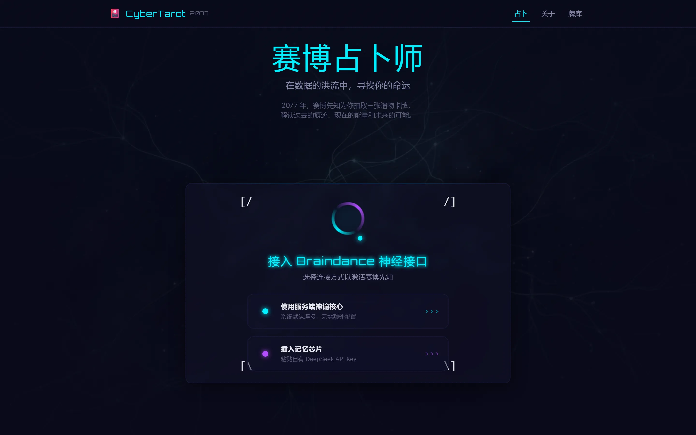
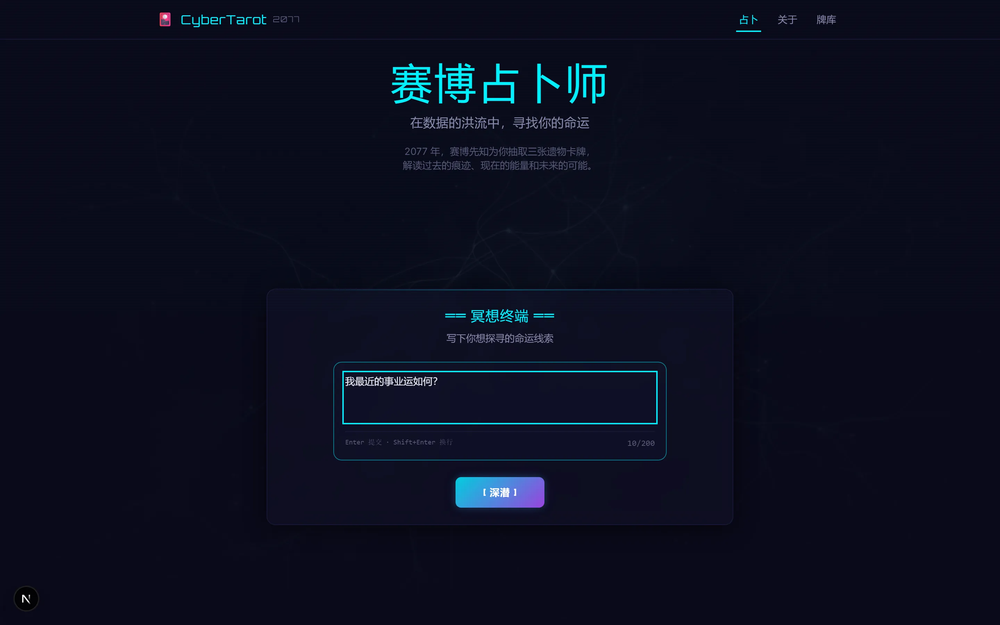
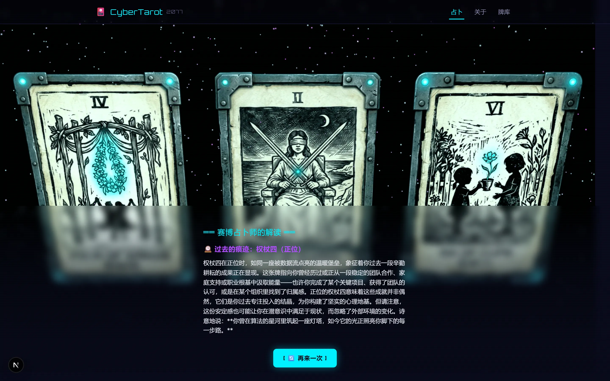
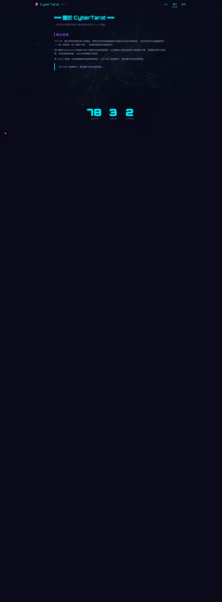
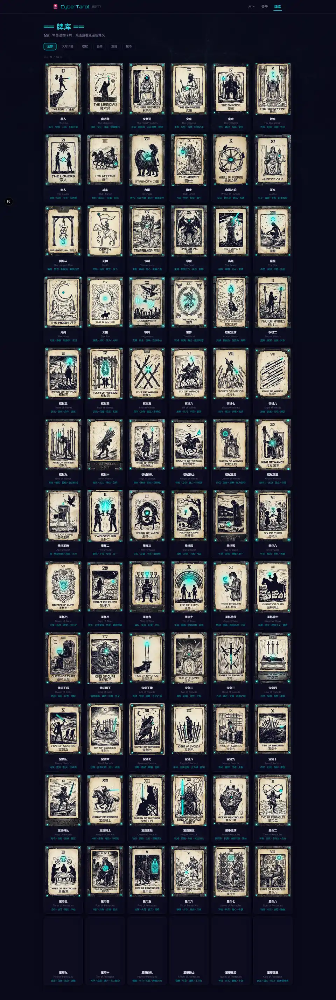

# CyberTarot 赛博占卜师

> 在 0 与 1 的缝隙中，寻找属于你的命运信号。

**CyberTarot** 是一个融合赛博朋克美学与 AI 塔罗占卜的 Web 应用。用户通过 Braindance 神经接口接入，由 DeepSeek AI 抽取三张遗物卡牌，解读过去、现状与未来。

🔮 **在线体验：** [https://cybertarot.vercel.app/?demo](https://cybertarot.vercel.app/?demo)（自动演示模式）

---

## 📸 界面预览

<p align="center">
  
  
</p>
<p align="center">
  <em>↑ Braindance 神经接口接入（左）与冥想终端问题输入（右）</em>
</p>

<br />

<p align="center">
  
</p>
<p align="center">
  <em>↑ 3D 翻牌桌 + DeepSeek AI 流式解读段落浮现</em>
</p>

<br />

<p align="center">
  
  
</p>
<p align="center">
  <em>↑ 关于页面（左）与 78 张牌库百科（右）</em>
</p>

---

## ✨ 核心功能

| 功能 | 说明 |
|------|------|
| **Braindance 神经接入** | 赛博朋克风格的 API Key 接入界面，支持服务端默认 Key 或自定义 Key |
| **3D 翻牌桌** | React Three Fiber 实现的粒子背景 + 三张卡牌 3D 翻转动画 |
| **AI 流式解读** | DeepSeek API 流式响应，段落分级浮现动画 |
| **78 张完整牌库** | 22 张大阿卡纳 + 56 张小阿卡纳，支持花色筛选与详情展开 |
| **自动降级** | WebGL 不可用时降级为 CSS 2D 卡牌，API 不可用时使用模板解读 |
| **面试演示模式** | `/?demo` 参数自动触发完整流程，零操作可达 |

## 🖥️ 技术栈

| 层 | 技术 | 用途 |
|----|------|------|
| 框架 | **Next.js 16** (App Router) | React Server Components + 流式 SSR |
| 3D | **React Three Fiber** + drei | WebGL 3D 翻牌桌与粒子背景 |
| 动画 | **Motion** (Framer Motion) | 页面过渡、段落浮现、交互动效 |
| AI | **DeepSeek API** (streaming) | 流式塔罗解读，10s 超时 + 自动重试 |
| 样式 | **Tailwind CSS v4** | 暗黑赛博配色系统 |
| 图片 | **Sharp** | 78 张卡面 PNG → WebP 批量压缩 |
| 语言 | **TypeScript** | 全量类型覆盖 |
| 部署 | **Vercel** | 自动 CI/CD，Hobby Plan |

## 🏗️ 系统架构

```
┌─────────────────────────────────────────────────────┐
│                    🖥  Client                         │
│  ┌──────────┐  ┌──────────┐  ┌───────────────────┐  │
│  │Braindance│──→│Question  │──→│TarotTable3D(R3F) │  │
│  │Portal    │  │Input     │  │+ ParticleBg       │  │
│  └──────────┘  └──────────┘  └────────┬──────────┘  │
│                                       │              │
│  ┌────────────────────────────────────▼───────────┐  │
│  │          ReadingStream (SSE 流式)              │  │
│  └──────────────────────┬─────────────────────────┘  │
└─────────────────────────┼───────────────────────────┘
                          │ POST /api/reading
┌─────────────────────────▼───────────────────────────┐
│                   🖥  Server                         │
│  ┌───────────────────────────────────────────────┐  │
│  │  Route Handler /api/reading                   │  │
│  │  ├─ AbortController (客户端断开中止)          │  │
│  │  ├─ 自动重试 (最多 2 次, 间隔 1s)            │  │
│  │  └─ 全部失败 → 模板降级 (5 套)               │  │
│  └───────────────────┬───────────────────────────┘  │
│                      │ DeepSeek API                  │
│  ┌───────────────────▼───────────────────────────┐  │
│  │  DeepSeek Chat (stream=true)                  │  │
│  │  系统 Prompt ~600 字 + 用户 Prompt           │  │
│  └───────────────────────────────────────────────┘  │
└─────────────────────────────────────────────────────┘
```

## 📦 本地开发

```bash
# 1. 克隆仓库
git clone https://github.com/你的用户名/cybertarot.git
cd cybertarot

# 2. 安装依赖
pnpm install

# 3. 配置环境变量
cp .env.local.example .env.local
# 编辑 .env.local，填入 DeepSeek API Key（可选，也支持前端输入）

# 4. 启动开发服务器
pnpm dev
# 访问 http://localhost:3000

# 5. 运行测试
pnpm test
# 55 个测试用例验证核心功能

# 6. 生产构建
pnpm build
```

## 🎮 演示模式

访问 `/?demo` 参数即可自动触发完整占卜流程：

```
https://cybertarot.vercel.app/?demo
```

也可使用自定义问题：
```
https://cybertarot.vercel.app/?q=我最近的感情运势如何？
```

## 📁 项目结构

```
src/
├── app/
│   ├── page.tsx              # 首页（Phase 驱动全流程）
│   ├── layout.tsx            # 全局布局 + SEO metadata
│   ├── about/page.tsx        # 关于页面
│   ├── cards/page.tsx        # 牌库百科页面
│   └── api/
│       ├── reading/route.ts  # DeepSeek 流式 API 路由
│       └── verify-key/route.ts # API Key 验证路由
├── components/
│   ├── TarotProvider.tsx      # 核心流程状态管理
│   ├── BraindancePortal.tsx   # 神经接口接入界面
│   ├── QuestionInput.tsx      # 冥想终端输入区
│   ├── TarotTable3D.tsx       # 3D 翻牌桌主场景
│   ├── CardMesh.tsx           # 单张 3D 卡牌
│   ├── ParticleBg.tsx         # 粒子背景
│   ├── CardSkeleton.tsx       # 骨架屏
│   ├── R3FErrorBoundary.tsx   # WebGL 降级边界
│   ├── ReadingStream.tsx      # 流式解读展示
│   ├── DemoTrigger.tsx        # 面试演示触发器
│   ├── Navbar.tsx             # 导航栏
│   ├── HeroOpening.tsx        # 开场动画
│   └── Panel.tsx              # 内容面板容器
├── data/
│   └── cards.ts               # 78 张塔罗牌数据
├── lib/
│   ├── drawEngine.ts          # Fisher-Yates 洗牌引擎
│   ├── deepseek.ts            # DeepSeek API 客户端
│   ├── fallbackReadings.ts    # 模板解读降级
│   ├── motionTokens.ts        # 动画常量
│   └── useFirstVisit.ts       # 首次访问 Hook
└── types/
    └── index.ts               # TypeScript 类型定义

design-system/                 # 设计系统文档
├── MASTER.md
└── pages/
    ├── home.md
    ├── about.md
    └── cards.md

public/assets/cards/           # 78+1 张卡牌图片
```

## 🧪 测试覆盖

```
✓ 55 tests passed (4 test suites)

- cards.test.ts    → 78 张牌数量/ID/花色/字段验证
- drawEngine.test.ts → 洗牌算法/正逆位概率/分布验证
- 组件/集成测试 → 核心流程验证
```

## 🚀 部署

项目已预配置 Vercel 部署：

1. Fork 或推送代码到 GitHub
2. 在 [Vercel](https://vercel.com) 导入仓库
3. 设置环境变量 `DEEPSEEK_API_KEY`
4. 部署完成！

也可自定义域名：
```bash
# vercel.json 已预配置，无需额外修改
```

## ⚡ 性能目标

| 指标 | 目标 |
|------|------|
| FCP | < 2s |
| TTI | < 3s |
| 3D 首次加载 | < 3s |
| LLM 首 token | < 4s |
| 单次占卜 | ≤ 15s |

## 🛡️ 降级保障

- **WebGL 不可用** → 自动降级 CSS 2D 卡牌，保留 HUD 风格
- **DeepSeek API 不可用** → 无感切换 5 套模板解读
- **网络中断** → 错误提示 + 重试连接
- **每日限额** → localStorage 30 次/日计数器

## 📋 面试话术要点

### 技术亮点
1. **全栈 AI 产品**：Next.js App Router + R3F 3D 渲染 + DeepSeek 流式 AI
2. **容错设计**：三层降级（WebGL → CSS 2D / API → 模板 / 超时 → 重试）
3. **性能优化**：图片批量压缩、3D 懒加载、纹理内存管理、低配模式
4. **用户体验**：赛博朋克 UI 一致性、开场动画引导、Phase 状态机驱动

### 架构决策
- 为什么用 R3F 而不是纯 CSS：面试展示 3D 能力，同时 ErrorBoundary 保障降级
- 为什么状态用 useReducer：多状态转换清晰可控，便于调试
- 为什么不分 ReadingProvider：ReadingStream 本地状态已隔离，避免过度抽象

---

## 📄 许可证

MIT

---

> 本项目为前端/AI 全栈面试作品集的一部分，展示 Next.js App Router + R3F 3D 渲染 + DeepSeek AI 集成能力。
