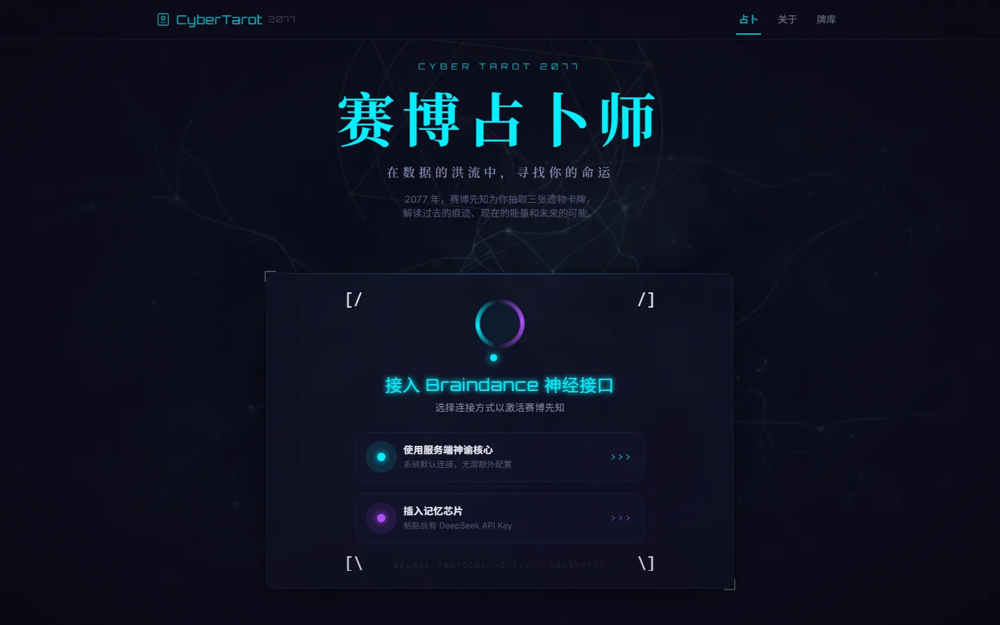
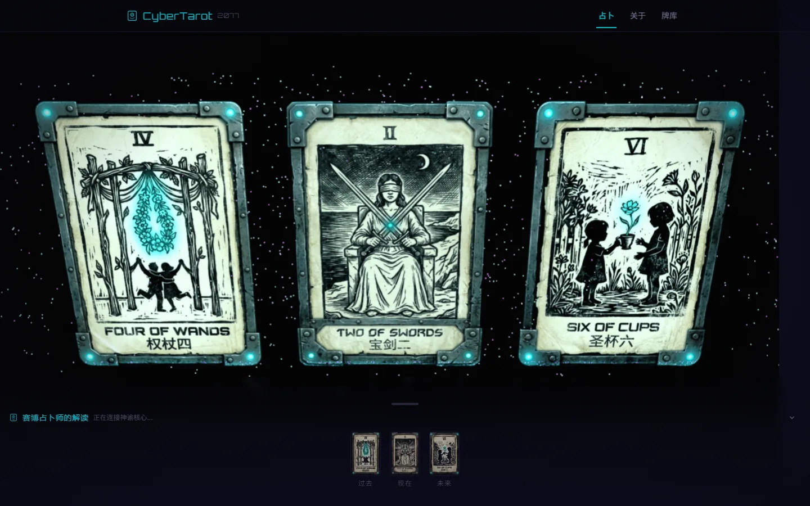
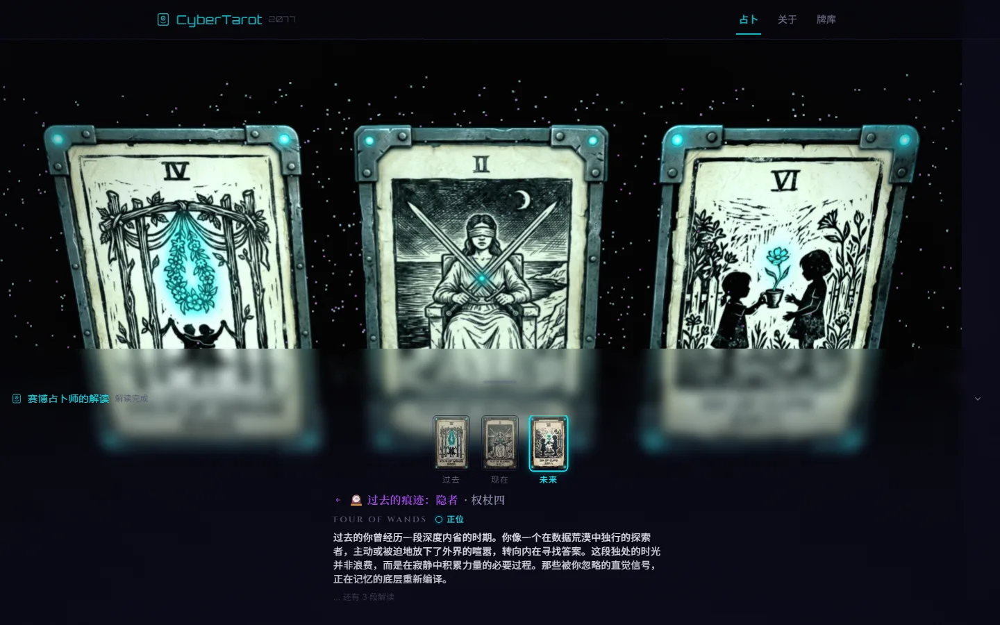
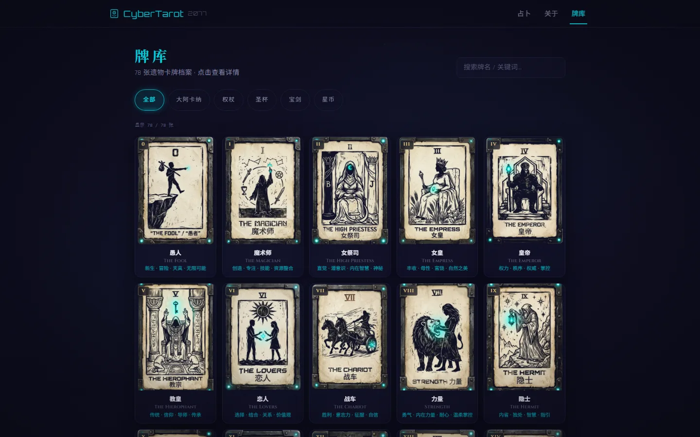
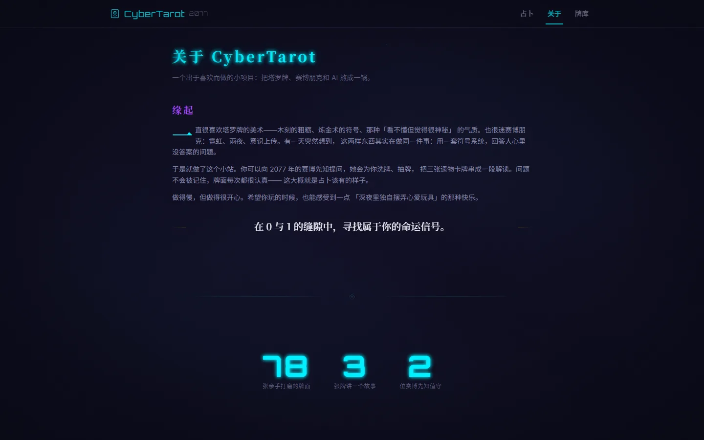
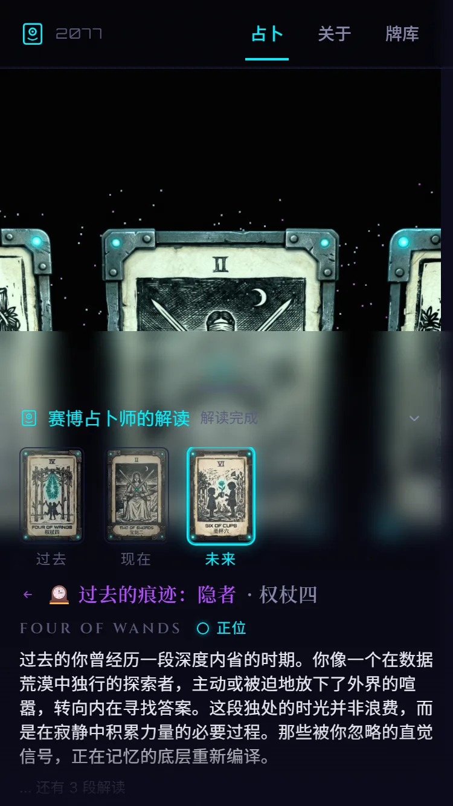

# CyberTarot 赛博占卜师

> 在 0 与 1 的缝隙中，寻找属于你的命运信号。

一个出于喜欢而做的小项目：把塔罗牌、赛博朋克和 AI 熬成一锅。
2077 年的赛博先知坐镇终端，你写下心事，她为你洗牌、抽牌，把三张遗物卡牌串成一段解读。

🔮 **在线体验：** [cybertarot.vercel.app/?demo](https://cybertarot.vercel.app/?demo)（自动演示模式，零操作看全流程）

---

## 界面预览

<p align="center">
  
  <br />
  <em>首页 · 衬线大标题 + 神圣几何，第一眼就是「神秘 × 科技」</em>
</p>

<br />

<p align="center">
  
  
  <br />
  <em>三张牌阵扫描揭示（左）· DeepSeek 流式解读与迷你牌导航（右）</em>
</p>

<br />

<p align="center">
  
  
  <br />
  <em>78 张遗物卡牌档案（左）· 关于页的创作故事（右）</em>
</p>

<br />

<p align="center">
  
  <br />
  <em>移动端 · 三张牌阵完整可见，解读收进底部卡片</em>
</p>

---

## 这个小站能做什么

- **接入仪式** — Braindance 神经接口开场：可以用服务端共享的神谕核心，也可以插入自己的「记忆芯片」（DeepSeek API Key）
- **洗牌抽牌** — 堆叠 → 扇形洗牌 → 三张依次飞位，牌没发完绝不让你看到牌面
- **三张牌阵** — 真 3D 牌桌（可以用鼠标转着看），粒子会向牌位汇聚，牌面以扫描溶解的方式逐张揭示
- **AI 解读** — DeepSeek 流式输出，按「过去 / 现在 / 未来」分段浮现；加粗的诗意句会自动被挑出来放大成引文卡
- **78 张牌库** — 木刻版画风的全套牌面，支持搜索和花色筛选，大阿卡纳有专属的罗马数字金标
- **随处降级** — WebGL 挂了变 CSS 2D，API 挂了换本地模板解读，尽量不让仪式中断

## 技术栈

| 层 | 选择 |
|----|------|
| 框架 | Next.js 16（App Router）+ TypeScript |
| 3D | React Three Fiber + drei（翻牌桌、粒子背景） |
| 动画 | Motion（页面过渡、洗牌仪式、段落浮现） |
| AI | DeepSeek API（流式，超时重试 + 模板降级） |
| 样式 | Tailwind CSS v4（自建的霓虹神秘主义设计系统） |
| 图片 | Sharp（78 张牌面批量压缩为 WebP） |
| 部署 | Vercel |

## 本地跑起来

```bash
git clone https://github.com/w3118597378-max/CyberTarot.git
cd CyberTarot
pnpm install

# 可选：配置服务端 Key（不配也能玩，前端会引导你输入）
cp .env.example .env.local   # 填入 DEEPSEEK_API_KEY=sk-...

pnpm dev                      # http://localhost:3000
pnpm test                     # 90 个测试用例
pnpm build                    # 生产构建
```

想直接看完整流程？访问 `/?demo` 会自动提问并走完全程；`/?q=你的问题` 可以自定义。

## 做的时候，最沉迷的部分

- **画一套自己的牌** — 78 张牌面全是木刻版画风：金属画框、做旧纸面、瞳孔里一点青光。为了让 22 张大阿卡纳看起来比小牌「更神圣」，边框做旧调了很多版
- **把抽牌做成仪式** — 不想让它像「查询结果」。发牌和揭示是两个严格分开的阶段，节奏对了，神秘感才对
- **慢即是神秘** — 环境动效全部 ≥1200ms：EEG 环 4s 呼吸、神圣几何 120s 缓转、星尘 60s 漂移；交互反馈保持 ≤300ms。快是科技，慢是仪式
- **中文字体的执念** — 标题用 Noto Serif SC 衬线切片加载，解读正文按 65ch 行长、1.9 倍行高排出「书感」，塔罗感不能全靠拉丁字体撑

## 项目结构（节选）

```
src/
├── app/
│   ├── page.tsx             # 首页：Phase 状态机驱动全流程
│   ├── cards/page.tsx       # 牌库
│   ├── about/               # 关于页（这个项目的创作故事）
│   └── api/reading/         # DeepSeek 流式路由（重试 + 模板降级）
├── components/
│   ├── TarotTable3D.tsx     # 3D 牌桌（响应式相机）
│   ├── ShuffleRitual.tsx    # 洗牌仪式：堆叠→扇形→飞位→溶解
│   ├── ReadingSheet.tsx     # 底部解读卡片（紧凑/展开双态）
│   └── …
├── data/cards.ts            # 78 张牌数据
└── lib/                     # 洗牌引擎 / API 客户端 / 动效常量

design-system/               # 设计系统文档（唯一的视觉规则源）
docs/screenshots/            # README 截图
```

## 许可证

MIT
